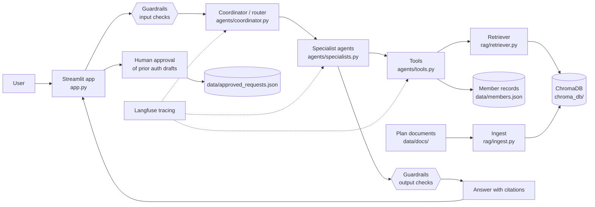

# Agentic RAG Starter Kit

A question-answering assistant for members of a health plan, built over the
plan's own documents. A coordinator agent sends each question to a specialist
agent. The specialists use tools to search a ChromaDB vector store of the
documents and to look up member records, and every answer cites its sources.
Guardrails check each question and answer. Prior authorization requests are
only drafted, and a person must approve them. Langfuse traces every run.

The sample data is a fictional plan, Lakeshore Health PPO, with fake members.

Built with LangChain, LangGraph, ChromaDB, OpenAI (gpt-4o-mini and
text-embedding-3-small) and Streamlit.

## Architecture



## Project layout

| Path | Job |
| --- | --- |
| `app.py` | Streamlit chat UI (entry point) with step progress, sources, guardrail notices and Approve / Reject for drafts |
| `agents/coordinator.py` | LangGraph graph: router, specialists, output check, conversation memory |
| `agents/specialists.py` | Two ReAct agents: Benefits and Prior Auth |
| `agents/tools.py` | `search_plan_documents`, `lookup_member`, `draft_prior_auth_request` |
| `rag/ingest.py` | Loads .md, .txt and .pdf files from `data/docs/` into ChromaDB |
| `rag/retriever.py` | Finds relevant chunks and answers from them with citations and a confidence flag |
| `guardrails/checks.py` | PII redaction, prompt-injection blocking, medical-advice blocking, missing-source flag |
| `observability/tracing.py` | Langfuse tracing and eval scores (the only file that imports langfuse) |
| `evals/eval_set.json` | 12 test cases with expected route, keywords and sources |
| `evals/run_eval.py` | Scores the pipeline against the test set |
| `data/docs/` | Source documents (sample: fictional Lakeshore Health PPO plan) |
| `data/members.json` | Fake member records used by the `lookup_member` tool |
| `Dockerfile`, `.dockerignore` | Container image (see Deploy) |

## Setup

Needs Python 3.12 or newer (tested on 3.14).

```powershell
python -m venv .venv
.\.venv\Scripts\Activate.ps1
pip install -r requirements.txt
```

Create a `.env` file with your keys. The Langfuse keys are optional, and
tracing is skipped without them.

```
OPENAI_API_KEY=...
LANGFUSE_PUBLIC_KEY=...
LANGFUSE_SECRET_KEY=...
LANGFUSE_HOST=https://us.cloud.langfuse.com
```

Build the vector store (run it again whenever the documents change):

```powershell
python -m rag.ingest
```

## Run the app

```powershell
streamlit run app.py
```

Then open http://localhost:8501. Try "I'm member M001, what's my deductible?",
then "Does an MRI need prior auth? Please start a request."

You can also test the pieces from the terminal:

```powershell
python -m rag.retriever "Is an MRI covered and does it need prior authorization?"
python -m agents.coordinator   # runs the memory and guardrail tests
```

## Run the eval

```powershell
python -m evals.run_eval
```

This runs the 12 cases in `evals/eval_set.json`, each in a fresh conversation.
A case passes only if four checks pass: the route, the expected keywords, the
grounding (the right source is cited, or the answer correctly refuses, or a
draft is created) and the guardrails. It prints a results table, the pass rate
and the median and p95 latency. With Langfuse keys set, each result is also
sent to Langfuse as a score on that case's trace.

## Deploy

The `Dockerfile` installs the packages, builds the vector store with
`python -m rag.ingest` during the build, and serves the app on port 8501.
No keys are stored in the image. `.dockerignore` keeps `.env`, `.venv`,
`chroma_db/`, `__pycache__` and `data/approved_requests.json` out of the image.

Ingest needs your OpenAI key to embed the documents, so pass it as a build
secret. Docker reads it from the environment variable and mounts it only for
the ingest step (this needs BuildKit, which is on by default in current Docker):

```powershell
$env:OPENAI_API_KEY = "sk-..."
docker build --secret id=openai_api_key,env=OPENAI_API_KEY -t agentic-starter-kit .
```

Pass the keys as environment variables when you start the container:

```powershell
docker run -p 8501:8501 `
  -e OPENAI_API_KEY -e LANGFUSE_PUBLIC_KEY -e LANGFUSE_SECRET_KEY -e LANGFUSE_HOST `
  agentic-starter-kit
```

Then open http://localhost:8501. Approved prior auth requests are saved inside
the container and are lost when it is removed. To keep them, create the file
on the host first (containing `[]`) and add
`-v ${PWD}/approved_requests.json:/app/data/approved_requests.json` to the run
command. Don't mount over all of `/app/data`, because the app reads
`members.json` and the documents from there.

## Design choices

- **A router plus specialists, not one big agent.** The router uses structured
  output, so it can only return `benefits`, `prior_auth` or `out_of_scope`.
  Each specialist gets only the tools it needs, and only the Prior Auth agent
  can draft requests. Out-of-scope questions get a fixed reply, and no
  specialist or tool runs.
- **Answers come from tools, with citations.** The specialists are told to
  answer only from what their tools return. The retriever answers only from
  the chunks it found and cites the file for each fact. If the best match is
  weak, it flags the answer as low confidence. If nothing relevant is found,
  it says so.
- **Guardrails sit outside the model.** The input check runs before anything
  reaches the model, the memory or Langfuse, so PII is redacted first and
  prompt-injection attempts are blocked early. The output check is the last
  step of the graph, so memory stores the checked answer, not the raw one. The
  checks are plain rules, so they are fast, cost nothing and give the same
  result every time.
- **A person stays in the loop.** The agent can only create a draft with the
  status `pending_approval`. Nothing is saved until a person clicks Approve in
  the app.
- **Memory is per conversation.** A LangGraph checkpointer saves the state
  under a `thread_id`, so follow-up questions and the member id carry over
  between turns.
- **Observability and evals from the start.** Each question becomes one
  Langfuse trace containing every node, model call and tool call, using only
  the redacted text. The eval suite checks routing, content, grounding and
  guardrails together, and records a score on each trace.
- **gpt-4o-mini at temperature 0.** It is cheap and fast enough for a demo,
  and temperature 0 keeps answers consistent between runs.

## Known limitations

- **The data is a demo.** There are three short plan documents and three fake
  members. Nothing is connected to real claims or eligibility systems, and
  approving a draft only writes it to a local JSON file.
- **Memory is in RAM.** Conversations are lost when the app restarts, and
  memory isn't shared between processes. A production version would use a
  database checkpointer such as Postgres.
- **The guardrails are rule-based.** The regex checks can miss PII or
  injection attempts phrased in unexpected ways. They can also over-block:
  every date is masked as a possible date of birth, and any dose such as
  "10 mg" in an answer triggers the medical-advice replacement. An
  LLM-based or ML classifier would catch more.
- **Retrieval is simple.** It uses vector search only (no keyword or hybrid
  search and no reranking), and the score cutoffs were tuned by hand on these
  documents. Ingest rebuilds the whole store each time.
- **The eval set is small.** Twelve cases show regressions but don't measure
  quality statistically, and the keyword checks can miss answers that are
  correct but worded differently.
- **No authentication.** Anyone who can open the app can choose any member
  id. Member data should sit behind a login before real use.
