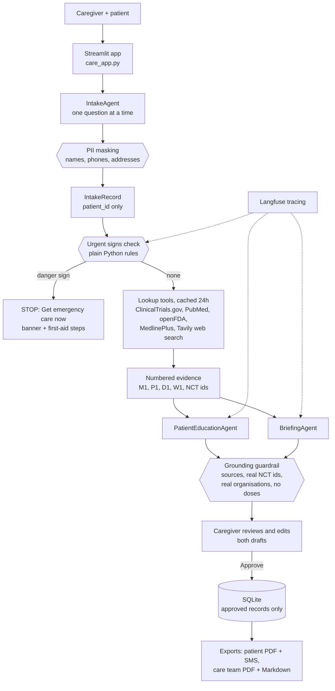
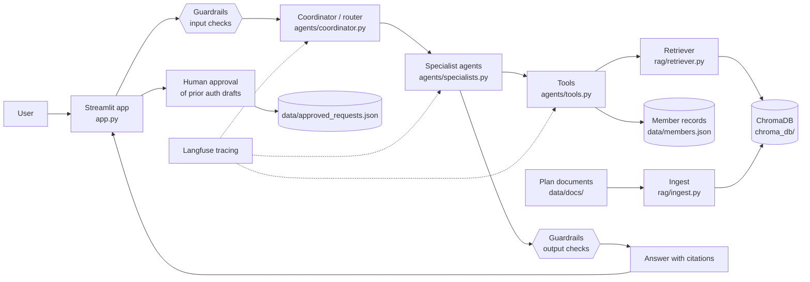

# Patient Intake & Condition Guide

For places where a doctor isn't readily available. A caregiver (community
health worker, nurse, medic or family caregiver) uses it with the patient to:

1. **Do a structured patient intake**, one plain-language question at a time.
2. **Give the patient a plain-language info sheet** about their condition, at
   about a 6th-grade reading level, in their preferred language.
3. **Give the care team a structured briefing**: current standard of care,
   emerging treatments in clinical trials, and the key companies and
   institutions.

**The app does not diagnose.** The condition is the one a health worker told
the patient about ("I was told I have ___"), or one the caregiver enters. It
never gives doses and never tells anyone to start, stop or change a medicine.

It is built on this repo's agentic starter kit (LangGraph, LangChain, OpenAI
gpt-4o-mini, guardrails, Streamlit, Langfuse, evals). The original health-plan
member assistant is still here and documented further down.

## How it works



## Files

| Path | Job |
| --- | --- |
| `care_app.py` | Streamlit app: Home, New Intake (one question per screen), Patient Info Sheet, Care Team Briefing, Patient History |
| `agents/intake_models.py`, `agents/intake_agent.py` | The IntakeRecord and the question-by-question IntakeAgent |
| `guardrails/intake_pii.py` | Masks names, phone numbers and addresses before any model call |
| `triage/urgent_signs.py` | Urgent signs check: plain Python rules, never the model |
| `tools/` | `clinicaltrials_search`, `pubmed_search`, `openfda_drugs`, `medlineplus_lookup`, `web_search`, the 24-hour SQLite cache, and `evidence.py` to run them all |
| `agents/care_evidence.py` | Numbers the tool results (M1, P1, D1, W1, NCT ids) for the agents to cite |
| `agents/care_models.py` | Pydantic shapes of the Patient Info Sheet and the Care Team Briefing |
| `agents/patient_education.py` | PatientEducationAgent (plain-language sheet) |
| `agents/briefing.py` | BriefingAgent (care team briefing) |
| `guardrails/grounding.py` | Output guardrail: grounding rules and the dose / prescribe / diagnose block |
| `agents/care_coordinator.py` | LangGraph flow: urgent check, then lookup, then both agents in parallel |
| `agents/care_store.py` | Saves approved records to `data/care_records.db` |
| `agents/care_export.py` | Patient PDF and SMS; care team PDF and Markdown |
| `evals/intake_cases.json`, `evals/condition_cases.json`, `evals/run_care_eval.py` | The eval |

## How to run

Needs Python 3.12 or newer (tested on 3.14).

```powershell
python -m venv .venv
.\.venv\Scripts\Activate.ps1
pip install -r requirements.txt
copy .env.example .env    # then fill in your keys
```

`.env` needs `OPENAI_API_KEY`. The Langfuse keys are optional: without them
tracing is off. `TAVILY_API_KEY` is optional too: without it web search is
off. The other four lookups need no key. Web search adds current WHO, CDC and
NICE guideline pages, so sections like "what you can do at home" are fuller.

Build the vector store once (the kit's member assistant uses it, and the
shared agent code opens it):

```powershell
python -m rag.ingest
```

Start the app:

```powershell
streamlit run care_app.py
```

Then open http://localhost:8501:

1. **Home** shows a few stat cards. Click **Start new intake**, optionally
   type the patient's name (it is used only to hide the name in answers), and
   click **Start**. A slim top bar shows the patient ID, an urgent-status
   pill, the language and **Exit** (back to Home; the intake is kept). A thin
   progress bar shows "Step X of 5 · section · time left". Each question sits
   in a center card: type the answer in the box right under the question or
   tap a big answer button, then tap **Next** (an empty answer is skipped,
   except age, which is required) or **Back**. Every answer so far is a
   chip at the bottom: tap one to edit it. Try "chest pain and sweating a
   lot" as the main problem: the whole page turns into the red **Get
   emergency care now** screen.
2. When the intake is done, check the condition and click **Make patient sheet
   and care team briefing** (about 15-40 seconds).
3. Review and edit both drafts, tick **I reviewed...** on each, then click
   **Approve and save**.
4. **Patient History**: download the patient PDF, the SMS text, or the care
   team PDF / Markdown.

Each piece can also be tried from the terminal:

```powershell
python -m triage.urgent_signs              # urgent signs rules on 5 examples
python -m tools.clinicaltrials malaria     # any of the five tools
python -m agents.patient_education malaria
python -m agents.briefing tuberculosis
python -m agents.care_coordinator          # one urgent and one calm patient
```

### Run the eval

```powershell
python -m evals.run_care_eval              # all 15 cases
python -m evals.run_care_eval intake       # the 10 intake cases only (fast)
python -m evals.run_care_eval condition    # the 5 condition cases only
```

- **10 intake cases**: 8 urgent cases (one for each danger sign, including
  shock found from the vitals alone) and 2 calm ones. They check that every
  urgent case stops with the right sign and that the coordinator stops too.
  They also check that calm cases don't stop, that the required fields are
  filled, and that names, phone numbers and addresses are masked. **A missed
  urgent case is an automatic FAIL.**
- **5 condition cases**: malaria, tuberculosis, type 2 diabetes, sickle cell
  disease and hypertension. They check that:
  - every section is present;
  - every NCT ID and every organisation appears in the raw tool output;
  - the sheet and the briefing each cite 3 or more sources;
  - the sheet reads at grade 8 or below (textstat);
  - nothing gives a dose, prescribes or diagnoses.
- With Langfuse keys, each case's pass/fail is sent as an `eval_pass` score
  on its trace, with the time in the comment. Langfuse also shows each run's
  duration.

Last run: intake 10/10, conditions 5/5 (median 13 seconds per condition).

### Docker

Build the image the same way as the original kit (see **Deploy** below). On
this branch the image starts the care guide (`care_app.py`) by default:

```powershell
docker run -p 8501:8501 -e OPENAI_API_KEY -e TAVILY_API_KEY `
  -e LANGFUSE_PUBLIC_KEY -e LANGFUSE_SECRET_KEY -e LANGFUSE_HOST `
  agentic-starter-kit
```

To start the original member assistant instead, add
`streamlit run app.py --server.address 0.0.0.0` to the end of that command.

Approved records are saved in `/app/data/care_records.db` inside the
container. To keep them, mount a folder for that one file. Don't mount over
all of `/app/data`.

## Safety notes

- **Urgent signs come first and can't be overridden.** After every answer,
  `triage/urgent_signs.py` checks for:
  - severe trouble breathing;
  - being unconscious or very hard to wake;
  - convulsions;
  - chest pain with sweating;
  - heavy bleeding;
  - being unable to drink or keep anything down;
  - signs of shock (including very low blood pressure or a very high pulse);
  - pregnancy with any bleeding.

  These are plain Python rules. On any match, the intake stops and the
  **Get emergency care now** banner appears with simple first-aid steps. The
  coordinator runs the same check first and ends before any model or tool
  call. The rules lean towards safety: a false alarm costs a trip to the
  clinic, while a missed sign can cost a life. Negated phrases ("no chest
  pain") don't trigger them.
- **No diagnosis, no prescribing, no doses.** The prompts forbid all three.
  The grounding guardrail then removes any line that matches dose,
  prescribing or diagnosis patterns, including doses inside trial
  intervention names. The app also warns about a caregiver's own edits that
  match these patterns, and Approve stays off until they are changed.
- **Personal details stay local.** Names, phone numbers, addresses, emails
  and dates are masked before anything reaches OpenAI or Langfuse. Model
  calls use the `patient_id`, never the name, and the name typed in the app
  is never saved. Safety notes on the sheet (pregnancy, allergies, current
  medicines, other conditions, young child) are written by Python from the
  intake, so the model can't leave them out.
- **A person approves everything.** Drafts are not saved. Only records the
  caregiver has reviewed and approved go into SQLite, and only approved
  records can be exported.
- **Every sheet carries the disclaimer:** "This is general information, not
  medical advice. Talk to a health worker about your care."
- **No patient data in git or the image.** `data/*.db` is in `.gitignore`
  and `.dockerignore`, and `.env` is never committed.

## How answers stay grounded

1. **Look up first, then write.** The coordinator runs the five lookup tools
   once. Both agents read only that evidence, as a numbered list: `M1`
   (MedlinePlus), `P1` (PubMed review with abstract), `D1` (FDA label), `W1`
   (web page from a trusted site) and real NCT IDs (ClinicalTrials.gov). The
   prompts say to use nothing else.
2. **Every fact is a Point with source ids.** The model must attach ids such
   as `["M1", "P2"]` to each statement.
3. **Python checks the draft** (`guardrails/grounding.py`):
   - ids that don't exist are removed, and a point left with no real source
     is dropped;
   - a research study or emerging treatment is kept only if its NCT ID came
     back from `clinicaltrials_search`. Studies offered to the patient must
     also be **recruiting**;
   - a company or institution is kept only if its name appears in a tool
     result. Names from the model's memory are dropped, and organisations are
     sorted into companies, academic, and government/NGO by keyword rules;
   - a section left empty says **"No current data found."**
4. **Python, not the model, writes the facts that are easy to get wrong.**
   It writes every source title and link, every trial's phase, status,
   sponsor, countries and link, and the intervention names (copied from the
   registry with doses cut off).
5. **The eval checks the guardrail.** It reads the raw tool output itself and
   fails a case if any NCT ID or organisation in the output isn't there.

What this does *not* prove: the guardrail checks that a cited source exists,
not that the source really says what the sentence says. The caregiver review
step is there for that. The cited ids stay visible in the editor so the
caregiver can check them.

## Known limitations

- **English headings on translated sheets.** Section headings and the
  disclaimer on the PDF are in English even when the content is in another
  language.
- **The reading-level check is English-only** (textstat's Flesch-Kincaid).
- **openFDA lists US-approved labels**, including repackagers. It shows which
  drugs are approved for a condition in the US, not what is available
  locally.
- **The urgent rules are keyword rules.** They catch the listed phrasings and
  vitals cut-offs, but an unusual description of a danger sign can be
  missed. Train caregivers to trust their own judgement first.
- **Without a Tavily key**, standard-of-care points come mainly from PubMed
  abstracts, and "what you can do at home" is often "No current data found."

---

## The original kit: Agentic RAG Starter Kit

A question-answering assistant for members of a health plan, built over the
plan's own documents. A coordinator agent sends each question to a specialist
agent. The specialists use tools to search a ChromaDB vector store of the
documents and to look up member records, and every answer cites its sources.
Guardrails check each question and answer. Prior authorization requests are
only drafted, and a person must approve them. Langfuse traces every run.

The sample data is a fictional plan, Lakeshore Health PPO, with fake members.

Built with LangChain, LangGraph, ChromaDB, OpenAI (gpt-4o-mini and
text-embedding-3-small) and Streamlit.

### Architecture



### Project layout

| Path | Job |
| --- | --- |
| `app.py` | Streamlit chat UI (entry point) with step progress, sources, guardrail notices and Approve / Reject for drafts |
| `agents/coordinator.py` | LangGraph graph: router, specialists, output check, conversation memory |
| `agents/specialists.py` | Two ReAct agents: Benefits and Prior Auth |
| `agents/tools.py` | `search_plan_documents`, `lookup_member`, `draft_prior_auth_request` |
| `rag/ingest.py` | Loads .md, .txt and .pdf files from `data/docs/` into ChromaDB |
| `rag/retriever.py` | Finds relevant chunks and answers from them with citations and a confidence flag |
| `guardrails/checks.py` | PII redaction, prompt-injection blocking, medical-advice blocking, missing-source flag |
| `observability/tracing.py` | Langfuse tracing and eval scores (the only file that imports langfuse) |
| `evals/eval_set.json` | 12 test cases with expected route, keywords and sources |
| `evals/run_eval.py` | Scores the pipeline against the test set |
| `data/docs/` | Source documents (sample: fictional Lakeshore Health PPO plan) |
| `data/members.json` | Fake member records used by the `lookup_member` tool |
| `Dockerfile`, `.dockerignore` | Container image (see Deploy) |

### Setup

Needs Python 3.12 or newer (tested on 3.14).

```powershell
python -m venv .venv
.\.venv\Scripts\Activate.ps1
pip install -r requirements.txt
```

Create a `.env` file with your keys. The Langfuse keys are optional, and
tracing is skipped without them.

```
OPENAI_API_KEY=...
LANGFUSE_PUBLIC_KEY=...
LANGFUSE_SECRET_KEY=...
LANGFUSE_HOST=https://us.cloud.langfuse.com
```

Build the vector store (run it again whenever the documents change):

```powershell
python -m rag.ingest
```

### Run the app

```powershell
streamlit run app.py
```

Then open http://localhost:8501. Try "I'm member M001, what's my deductible?",
then "Does an MRI need prior auth? Please start a request."

You can also test the pieces from the terminal:

```powershell
python -m rag.retriever "Is an MRI covered and does it need prior authorization?"
python -m agents.coordinator   # runs the memory and guardrail tests
```

### Run the eval

```powershell
python -m evals.run_eval
```

This runs the 12 cases in `evals/eval_set.json`, each in a fresh conversation.
A case passes only if four checks pass: the route, the expected keywords, the
grounding (the right source is cited, or the answer correctly refuses, or a
draft is created) and the guardrails. It prints a results table, the pass rate
and the median and p95 latency. With Langfuse keys set, each result is also
sent to Langfuse as a score on that case's trace.

### Deploy

The `Dockerfile` installs the packages, builds the vector store with
`python -m rag.ingest` during the build, and serves the app on port 8501.
No keys are stored in the image. `.dockerignore` keeps `.env`, `.venv`,
`chroma_db/`, `__pycache__` and `data/approved_requests.json` out of the image.

Ingest needs your OpenAI key to embed the documents, so pass it as a build
secret. Docker reads it from the environment variable and mounts it only for
the ingest step (this needs BuildKit, which is on by default in current Docker):

```powershell
$env:OPENAI_API_KEY = "sk-..."
docker build --secret id=openai_api_key,env=OPENAI_API_KEY -t agentic-starter-kit .
```

Pass the keys as environment variables when you start the container:

```powershell
docker run -p 8501:8501 `
  -e OPENAI_API_KEY -e LANGFUSE_PUBLIC_KEY -e LANGFUSE_SECRET_KEY -e LANGFUSE_HOST `
  agentic-starter-kit
```

Then open http://localhost:8501. Approved prior auth requests are saved inside
the container and are lost when it is removed. To keep them, create the file
on the host first (containing `[]`) and add
`-v ${PWD}/approved_requests.json:/app/data/approved_requests.json` to the run
command. Don't mount over all of `/app/data`, because the app reads
`members.json` and the documents from there.

### Design choices

- **A router plus specialists, not one big agent.** The router uses structured
  output, so it can only return `benefits`, `prior_auth` or `out_of_scope`.
  Each specialist gets only the tools it needs, and only the Prior Auth agent
  can draft requests. Out-of-scope questions get a fixed reply, and no
  specialist or tool runs.
- **Answers come from tools, with citations.** The specialists are told to
  answer only from what their tools return. The retriever answers only from
  the chunks it found and cites the file for each fact. If the best match is
  weak, it flags the answer as low confidence. If nothing relevant is found,
  it says so.
- **Guardrails sit outside the model.** The input check runs before anything
  reaches the model, the memory or Langfuse, so PII is redacted first and
  prompt-injection attempts are blocked early. The output check is the last
  step of the graph, so memory stores the checked answer, not the raw one. The
  checks are plain rules, so they are fast, cost nothing and give the same
  result every time.
- **A person stays in the loop.** The agent can only create a draft with the
  status `pending_approval`. Nothing is saved until a person clicks Approve in
  the app.
- **Memory is per conversation.** A LangGraph checkpointer saves the state
  under a `thread_id`, so follow-up questions and the member id carry over
  between turns.
- **Observability and evals from the start.** Each question becomes one
  Langfuse trace containing every node, model call and tool call, using only
  the redacted text. The eval suite checks routing, content, grounding and
  guardrails together, and records a score on each trace.
- **gpt-4o-mini at temperature 0.** It is cheap and fast enough for a demo,
  and temperature 0 keeps answers consistent between runs.

### Known limitations

- **The data is a demo.** There are three short plan documents and three fake
  members. Nothing is connected to real claims or eligibility systems, and
  approving a draft only writes it to a local JSON file.
- **Memory is in RAM.** Conversations are lost when the app restarts, and
  memory isn't shared between processes. A production version would use a
  database checkpointer such as Postgres.
- **The guardrails are rule-based.** The regex checks can miss PII or
  injection attempts phrased in unexpected ways. They can also over-block:
  every date is masked as a possible date of birth, and any dose such as
  "10 mg" in an answer triggers the medical-advice replacement. An
  LLM-based or ML classifier would catch more.
- **Retrieval is simple.** It uses vector search only (no keyword or hybrid
  search and no reranking), and the score cutoffs were tuned by hand on these
  documents. Ingest rebuilds the whole store each time.
- **The eval set is small.** Twelve cases show regressions but don't measure
  quality statistically, and the keyword checks can miss answers that are
  correct but worded differently.
- **No authentication.** Anyone who can open the app can choose any member
  id. Member data should sit behind a login before real use.
