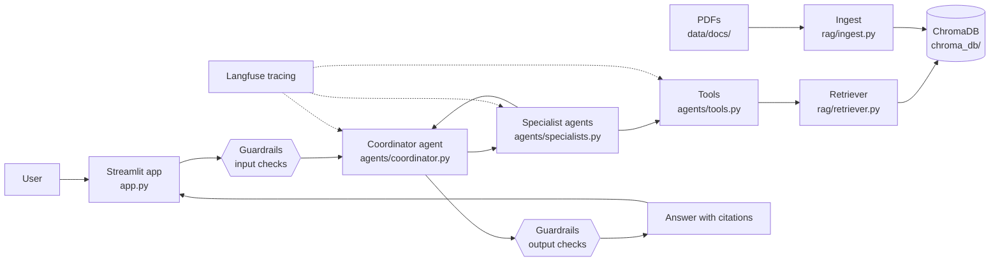

# Agentic RAG Starter Kit

A starter project for a question-answering assistant over your own PDF documents.
A coordinator agent passes each question to specialist agents. The specialists
use tools to search a ChromaDB vector store of your documents, and the answer
comes back with citations. Guardrails check questions and answers, and Langfuse
traces every run.

Built with LangChain, LangGraph, ChromaDB, OpenAI and Streamlit.

## Architecture



## Project layout

| Path | Job |
| --- | --- |
| `app.py` | Streamlit chat UI (entry point) |
| `agents/coordinator.py` | Routes questions to specialists and assembles the answer |
| `agents/specialists.py` | Specialist agents that do the work |
| `agents/tools.py` | Tools the agents can call, such as document search |
| `rag/ingest.py` | Loads .md, .txt and .pdf files from `data/docs/` into ChromaDB |
| `rag/retriever.py` | Finds relevant chunks and answers from them with citations |
| `guardrails/checks.py` | PII redaction, prompt-injection blocking, medical-advice blocking, missing-source flag |
| `evals/eval_set.json` | Test questions with expected answers |
| `evals/run_eval.py` | Scores the pipeline against the test set |
| `data/members.json` | Fake member records used by the `lookup_member` tool |
| `data/docs/` | Source documents (sample: fictional Lakeshore Health PPO plan) |

## Setup

```powershell
python -m venv .venv
.\.venv\Scripts\Activate.ps1
pip install -r requirements.txt
```

Create a `.env` file with your keys:

```
OPENAI_API_KEY=...
LANGFUSE_PUBLIC_KEY=...
LANGFUSE_SECRET_KEY=...
LANGFUSE_HOST=https://us.cloud.langfuse.com
```

Build the vector store and ask a question from the terminal:

```powershell
python -m rag.ingest
python -m rag.retriever "Is an MRI covered and does it need prior authorization?"
python -m agents.coordinator   # runs the memory and guardrail tests
```

Then run `streamlit run app.py`.

## Deploy

The `Dockerfile` installs the packages, builds the vector store with
`python -m rag.ingest` during the build, and serves the app on port 8501.
No keys are stored in the image. `.dockerignore` keeps `.env`, `.venv`,
`chroma_db/`, `__pycache__` and `data/approved_requests.json` out of the image.

Ingest needs your OpenAI key to embed the documents, so pass it as a build
secret. Docker reads it from the environment variable and mounts it only for
the ingest step (this needs BuildKit, which is on by default in current Docker):

```powershell
$env:OPENAI_API_KEY = "sk-..."
docker build --secret id=openai_api_key,env=OPENAI_API_KEY -t agentic-starter-kit .
```

Pass the keys as environment variables when you start the container:

```powershell
docker run -p 8501:8501 `
  -e OPENAI_API_KEY -e LANGFUSE_PUBLIC_KEY -e LANGFUSE_SECRET_KEY -e LANGFUSE_HOST `
  agentic-starter-kit
```

Then open http://localhost:8501. Approved prior auth requests are saved inside
the container and are lost when it is removed. To keep them, create the file
on the host first (containing `[]`) and add
`-v ${PWD}/approved_requests.json:/app/data/approved_requests.json` to the run
command. Don't mount over all of `/app/data`, because the app reads
`members.json` and the documents from there.

> Status: the RAG layer, agents, conversation memory (in RAM, per thread_id), rule-based guardrails and the Streamlit app work. Prior auth drafts are only saved to `data/approved_requests.json` after a person clicks Approve. Every question is traced in Langfuse (redacted text only; tracing is skipped if the keys are missing), and `python -m evals.run_eval` runs the 12-case eval suite and sends each pass/fail to Langfuse as a score.
> Member data in `data/members.json` is fake.
