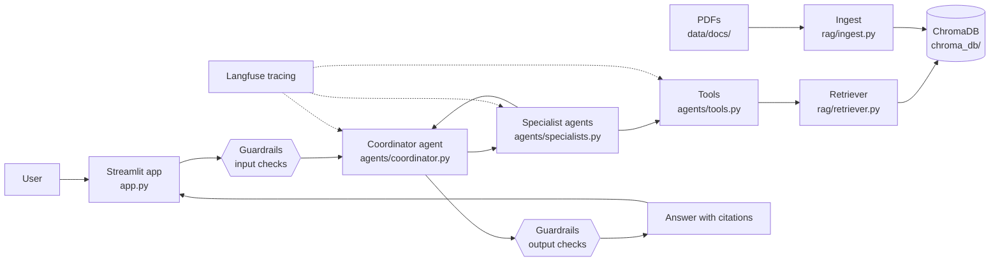

# Agentic RAG Starter Kit

A starter project for a question-answering assistant over your own PDF documents.
A coordinator agent passes each question to specialist agents. The specialists
use tools to search a ChromaDB vector store of your documents, and the answer
comes back with citations. Guardrails check questions and answers, and Langfuse
traces every run.

Built with LangChain, LangGraph, ChromaDB, OpenAI and Streamlit.

## Architecture



## Project layout

| Path | Job |
| --- | --- |
| `app.py` | Streamlit chat UI (entry point) |
| `agents/coordinator.py` | Routes questions to specialists and assembles the answer |
| `agents/specialists.py` | Specialist agents that do the work |
| `agents/tools.py` | Tools the agents can call, such as document search |
| `rag/ingest.py` | Loads PDFs from `data/docs/` into ChromaDB |
| `rag/retriever.py` | Finds relevant chunks for a question |
| `guardrails/checks.py` | Input and output safety checks |
| `evals/eval_set.json` | Test questions with expected answers |
| `evals/run_eval.py` | Scores the pipeline against the test set |
| `data/docs/` | Put your source PDFs here |

## Setup

```powershell
python -m venv .venv
.\.venv\Scripts\Activate.ps1
pip install -r requirements.txt
```

Create a `.env` file with your keys:

```
OPENAI_API_KEY=...
LANGFUSE_PUBLIC_KEY=...
LANGFUSE_SECRET_KEY=...
LANGFUSE_HOST=https://us.cloud.langfuse.com
```

Then run `streamlit run app.py`.

> Status: skeleton only. The modules describe their jobs but contain no logic yet.
